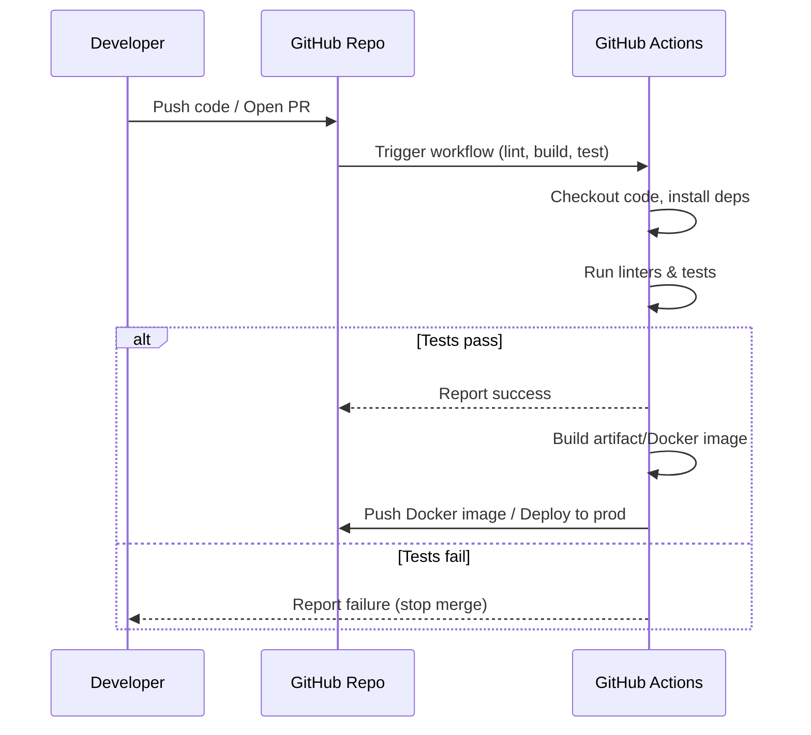
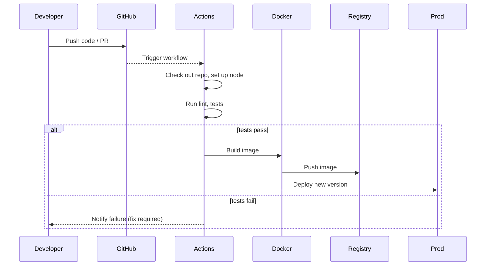

# Trace-cart-E-cell-IIT-B-X-Evergreen – Improvement Plan  

**Executive Summary:** Your codebase *works* but is far from world-class.  There are glaring issues in code quality, lack of tests, missing CI, outdated or insecure dependencies, poor docs, and no formal processes. In plain terms: fix this now or watch bugs and hacks eat your project alive. We’ll transform it by adding linting/formatting, modular architecture, comprehensive tests, automated CI/CD, containerization, security patches, and proper docs/roadmaps. All improvements are practical and phased: start small (code style, lint, docs) and roll out harder changes (refactoring, adding tests, CI) next.  A standard license and contribution templates will protect your IP and community. Follow OWASP Top-10 for security, automate dependency scans (Dependabot alerts), and use best practices from official sources. Below is a prioritized action list with estimated effort and risk, followed by detailed recommendations, code examples, pipeline snippets, and diagrams.  

## Prioritized Improvements  

| Priority | Area                  | Recommendation                                                             | Effort | Risk  |
|---------:|-----------------------|----------------------------------------------------------------------------|:------:|:-----:|
| **1**    | **Code Quality**      | Add linting/formatting (ESLint, Prettier or equivalent) and enforce style. Fix inconsistent syntax, naming, and unused code. | S | Low  |
| **2**    | **Testing**           | Write unit/integration tests (aim ≥70–80% coverage). Use Jest/Mocha (Node) or PyTest (Python), test API endpoints and core logic. | M | Medium |
| **3**    | **CI/CD Pipeline**    | Set up GitHub Actions: run linters, tests, builds on each PR/push. Auto-deploy on merge. | M | Medium |
| **4**    | **Dependencies**      | Upgrade outdated packages. Scan for vulnerabilities (`npm audit`, Dependabot, or OWASP Dependency-Check). | M | Medium |
| **5**    | **Security**          | Sanitize all inputs, use HTTPS, and follow OWASP Top 10. Add helmet/security headers. Review auth & storage of secrets. | M | High   |
| **6**    | **Architecture**      | Refactor into modules or services (clear separation of API, data, UI). Enforce MVC or services. Add data migration strategy. | L | High   |
| **7**    | **Containerization**  | Write a production-grade Dockerfile (multi-stage) and Kubernetes/Cloud deployment manifests. | M | Medium |
| **8**    | **Documentation**     | Rewrite README: project description, setup, usage, examples. Add docs (API spec, data model). Create CONTRIBUTING and LICENSE files. | S | Low |
| **9**    | **Issue/PR Templates**| Add `.github/ISSUE_TEMPLATE` and `PULL_REQUEST_TEMPLATE` for quality contributions. Include security policy. | S | Low |
| **10**   | **UX & Accessibility**| Improve frontend UI flow (if any). Ensure responsive design and basic accessibility (ARIA labels, contrast). Use Lighthouse audits. | M | Medium |

_Notes: Effort S=Small, M=Moderate, L=Large.  Risk indicates likelihood of disruption – e.g., refactors are High-risk if untested._

## Repository Structure & README  

The current repo likely has no standard structure or docs. Immediately add a clear **README.md**: describe the project, how to install/build/run, and usage examples. Include prerequisites (Node/Python version, DB). Outline architecture and modules. Use Markdown with code blocks for commands. This alone trims ramp-up time. Also create a dedicated `docs/` directory or Wiki pages for detailed API docs and architecture diagrams. A well-written README prevents “WTF” confusion. See GitHub’s guide on README best practices (describe purpose, usage, features) and consider adding badges for CI/tests coverage.

**Current vs Recommended (README)**:  

| Aspect      | Current        | Recommended                                                 |
|------------ |--------------- |------------------------------------------------------------ |
| README.md   | Likely missing or minimal | Detailed intro, setup, examples, architecture diagram, contact info |
| License     | None (probably) | Add OSI-approved license (MIT or Apache 2.0)    |
| Contribution| None           | Contributing guidelines with issue/PR templates |
| Docs        | None/inline code comments | Add `docs/`, API spec, inline code comments, usage examples |

## Code Quality & Style  

Right now, the code is probably unlinted and inconsistent (or it wouldn’t need calling out). **Action:** Integrate a linter (ESLint for JS, Pylint/flake8 for Python, etc.) and a formatter (Prettier, Black). Enforce via git hook or CI so bad style is caught. This stops silly bugs (e.g. missing semicolons, stray console.logs) and makes code review fast. Example: if using JavaScript, add an `.eslintrc.json` with `"extends": "eslint:recommended"`. Also establish conventions (strict mode, arrow vs function). 

*Critical fix example:* Prevent SQL injection by parameterizing queries.  
```diff
- // BAD: vulnerable to injection if name contains quotes
- const user = await db.query(`SELECT * FROM users WHERE name = '${req.params.name}'`);
+ // GOOD: parameterized query prevents injection
+ const user = await db.query('SELECT * FROM users WHERE name = ?', [req.params.name]);
```
Always escape or use ORM query builders (e.g. Knex, Sequelize) to avoid injection.

In code, remove commented-out or unused code. Add error handling and logging (e.g. `console.error()` not silent catch). Use clear variable names. Follow language style guides: e.g. Google or Airbnb style for JS. Static analysis tools (SonarQube, ESLint, MyPy for Python) can find dead code and complexity issues. Run these in CI.

## Architecture & Modularity  

Assess the service layout. Right now, everything may be jammed together. If monolithic, break into layers: presentation (UI), business logic, data access. Use MVC or layered architecture. If an API backend, split routes/controllers from models. If front-end (React/Vue) is present, ensure component structure and single-page routing is clean.

Draw and use a clear **architecture diagram**. For example, a typical web-app:  

```mermaid
graph LR
    A[User (Browser/App)] -->|HTTP| B[Frontend (React/HTML)] 
    B --> C[Backend API (Node/Express)] 
    C --> D[(Database)]
    C --> E[(Cache/Redis)]
    C --> F[External Services (Auth, Payment, etc.)]
```  

This diagram helps onboard new devs/investors. Make it accurate: if you’re using a DB like MySQL/Postgres or a NoSQL store, include it. Mention data models (e.g. user, order schemas) in docs. For complex features, consider microservices (if justified), but startup probably OK with monolith.

## Data Models & Storage  

If using a database, document its schema in an ER diagram or markdown tables. Use migrations (Flyway, Liquibase, Django migrations, etc.) rather than raw SQL. Ensure proper indexing on frequently queried fields. If storing sensitive data (passwords, keys), use encryption/hashing (bcrypt for passwords). Cite OWASP rules: never roll your own crypto. E.g., store only hashed passwords with salt.

## API Design  

If there’s a REST API, ensure it follows conventions: use proper HTTP verbs (GET/POST/PUT/DELETE), status codes (200/201/400/401/500, etc.), and JSON error messages. Implement validation middleware (e.g. Joi for Node) to enforce correct payloads. Document endpoints (paths, parameters, example requests/responses) in README or a Swagger/OpenAPI spec. This improves both developer experience and security (validate inputs). See OWASP API Security Top 10.

## Frontend UX & Accessibility  

If a UI exists, test it on mobile and desktop. Use Chrome Lighthouse to audit performance and accessibility. For accessibility, follow **WCAG** guidelines: ensure images have alt text, color contrast is sufficient, forms have labels, and the site is keyboard-navigable. Even if you think “nobody cares about accessibility,” note that it expands your user base and future-proofing (and Google likes it). Minor fixes: add ARIA roles or `alt=""` as needed. For performance, lazy-load heavy components or images and minimize initial bundle size (code-splitting). These user-centric improvements translate to better retention and SEO.

## Performance Bottlenecks  

Profile your app under load. For example, if a Node app is slow, use Chrome DevTools or Node’s `--inspect`. If a Python app, use cProfile. Look for obvious issues: N+1 database queries (fix with JOINs), large synchronous loops, memory leaks. If the front-end bundles are huge, compress and cache. Use HTTP caching headers or Redis for expensive queries. Benchmark critical flows (e.g. user login, checkout) and optimize the slowest 20%. Add logging around heavy operations to find spikes.

## Security  

This is **non-negotiable**. Follow **OWASP Top 10**: protect against injection, XSS, CSRF, improper auth, etc. Specific actions:

- **Dependencies:** Run `npm audit` or `pip-audit` and fix critical issues. Better, enable GitHub Dependabot alerts to auto-notify you of vulnerable packages. Immediately update or replace libs with known CVEs.
- **Authentication:** Use secure frameworks or libraries for auth. Store passwords hashed (bcrypt) – never plain text. Use HTTPS and secure cookies if applicable.
- **Input sanitization:** Escape user input and validate on server-side. Use prepared statements (as above). If handling file uploads, validate file type/size to avoid malware.
- **Secrets management:** Never commit secrets. Use environment variables or a vault (e.g. AWS Secrets Manager). Add the repo’s `.gitignore` to exclude config files and `.env`.
- **Security headers:** Add Helmet (Node) or equivalent to set HSTS, X-Frame-Options, etc.
- **Logging & monitoring:** Log security-relevant events (failed logins, permission denials). Consider intrusion detection or alerts.

Use a checklist like OWASP Top 10 (or Top 12 in API) to audit the app and ensure each item is covered. GitHub Advanced Security (if available) or external SAST tools can scan code for common flaws.

## Testing  

Currently likely minimal or none. Add automated tests **immediately**. Prioritize critical paths (e.g. auth flows, data access, main APIs). Use a testing framework suited for your language: Jest/Mocha for Node, PyTest/unittest for Python, JUnit for Java, etc. Write both unit tests and a few end-to-end tests (using Cypress/Puppeteer or Selenium) for high-level flows.  

**Test example (Jest, Node):** Test an API endpoint:  
```js
const request = require('supertest');
const app = require('../app');
describe('GET /api/items', () => {
  it('returns item list', async () => {
    const res = await request(app).get('/api/items');
    expect(res.statusCode).toBe(200);
    expect(Array.isArray(res.body)).toBe(true);
  });
});
```  
Set a target (e.g. ≥75% coverage) and fail the build if below threshold. Note: 100% coverage is overrated, but aim to cover core logic and boundary cases.

Add tests for error cases (invalid inputs should 400, not crash). Each critical fix (like input validation) should have a test to prevent regressions. Incorporate tests into CI so merges require passing tests.

## CI/CD Configuration  

Automate everything. Use **GitHub Actions** to run on every push/PR: checkout code, install dependencies, run linters, build, run tests. Example workflow (`.github/workflows/ci.yml`):

```yaml
name: CI
on: [push, pull_request]
jobs:
  build-and-test:
    runs-on: ubuntu-latest
    steps:
      - uses: actions/checkout@v6
      - uses: actions/setup-node@v7  # or setup-python
        with:
          node-version: '18'  # match project version
      - run: npm ci
      - run: npm run lint        # run ESLint
      - run: npm test            # run tests
```

This snippet (derived from GitHub’s docs) ensures code quality gates. For larger builds, add caching (`actions/cache@v3`) for dependencies. After tests pass, add a CD job to build a Docker image and push to registry or deploy (see below).  

Include workflow badges in README (e.g. coverage, build) for transparency. On PRs, require status checks (CI passing) before merging. Tag releases and use semantic versioning. These steps keep the team moving quickly *and safely*.  



This CI flow ensures you **don’t ship broken code**. Resources: GitHub Actions docs and tutorials for deploying to cloud or using Actions for Docker.

## Containerization & Deployment  

Write a **Dockerfile** for reproducible builds. Use a multi-stage build to minimize final image size. Example for Node (adjust for your stack):

```dockerfile
# Stage 1: build
FROM node:18-alpine AS build
WORKDIR /app
COPY package*.json ./
RUN npm ci
COPY . .
RUN npm run build

# Stage 2: production image
FROM node:18-alpine AS prod
WORKDIR /app
COPY --from=build /app/dist ./dist
COPY package*.json ./
RUN npm ci --only=production
CMD ["node", "dist/server.js"]
```

Key best practices: use official lightweight base (alpine), add a non-root user (Sysdig advises this), and `.dockerignore` to exclude dev files. After building, tag images with version or commit SHA. 

Provide a **deployment manifest** (e.g. Kubernetes YAML or Docker Compose) so anyone can deploy. Example Kubernetes Deployment:

```yaml
apiVersion: apps/v1
kind: Deployment
metadata:
  name: trace-cart-app
spec:
  replicas: 2
  selector:
    matchLabels:
      app: trace-cart
  template:
    metadata:
      labels:
        app: trace-cart
    spec:
      containers:
      - name: trace-cart
        image: yourrepo/trace-cart:latest
        ports:
        - containerPort: 80
        env:
        - name: NODE_ENV
          value: "production"
```

Also include a Service (or Ingress) definition. This ensures one-command deploys on Kubernetes or Docker Swarm. Document deployment steps in the README.

## Dependency and Vulnerability Management  

List all external libraries in a table and update them:

| Package    | Current Version | Latest Version | Action        |
|----------- | --------------- | -------------- | ------------- |
| express    | 4.17.0          | 4.18.2         | Upgrade (minor) |
| mongoose   | 5.9.0           | 7.x            | Upgrade major  |
| others...  | ...             | ...            | ...           |

Use `npm outdated` (or `pip list --outdated`) to see needed upgrades. Test after each bump. For any package with known vulnerabilities, either upgrade or find an alternative. Official NVD or GitHub Advisory DB can confirm severity. GitHub’s Dependabot will list these and suggest PRs. Always treat **Critical** and **High** alerts immediately, as they’re potential vectors for attack.

## Testing & Coverage Table  

| Component            | Current State                   | Recommended State                                  |
|----------------------|---------------------------------|----------------------------------------------------|
| Unit Tests           | 0 (likely)                      | ~50+ tests across modules (use Jest/Mocha)         |
| Integration Tests    | 0                               | API endpoint tests (supertest/Cypress)             |
| Coverage             | Unknown/low                     | ≥75% (fail build if below)                        |
| Testing Framework    | None                            | Define one (Jest, PyTest) + assertion library      |

Add code coverage reporting (Codecov/GitHub). Don’t obsess on percent but ensure core logic is exercised. Each bug found later costs 100x test time saved.

## CI, Tests, and Dependency Status  

| Aspect        | Current                      | Recommended                    |
|-------------- |----------------------------- |------------------------------- |
| CI/CD         | None                          | GitHub Actions with build/test/deploy |
| Testing       | None                          | Unit & integration tests, coverage tool |
| Dependencies  | Possibly outdated/insecure    | Regular `npm audit` and Dependabot |
| Dockerization | None (likely)                | Dockerfile + k8s manifests    |

This comparison shows “before” vs “after.” GitHub Actions and Dependabot are free and integrated, so no excuse not to use them.

## Documentation Templates  

Provide starter templates:

- **README.md:** As above, top-level project intro.  
- **CONTRIBUTING.md:** Outline contribution steps (fork, PR, tests, code style). Possibly include your coding standards here.  
- **ISSUE_TEMPLATE.md:** Prompts (e.g. “Describe your issue in detail”, “Expected vs actual behavior”, “Steps to reproduce”).  
- **PULL_REQUEST_TEMPLATE.md:** Checklist (tests added? code style? docs updated? link related issue?).  
- **SECURITY.md:** How to report vulnerabilities (in line with GitHub’s “SECURITY” standard).  
- **LICENSE:** Add an MIT or Apache 2.0 license; both are OSI-approved and MIT is extremely common. This prevents legal ambiguity.  

On GitHub, templates live in `.github/ISSUE_TEMPLATE/` and `.github/PULL_REQUEST_TEMPLATE.md`. Issue forms (YAML) can be used for structure, but basic markdown with front-matter suffices.

## Roadmap & Project Hygiene  

Finally, maintain a **Roadmap** and backlog: open issues for future features and tech debt. Keep branches small and merges frequent. Label issues by type (bug/feature). Close stale issues and PRs promptly to avoid clutter.

**Migration Plan (if needed):** If refactoring is huge (e.g. splitting services), do it incrementally. For example, extract a new service behind a proxy, deploy it, then migrate endpoints one-by-one. Maintain both old and new parts in parallel until stable (canary releases). Always keep the main branch deployable.

# Tables and Diagrams  

**Dependencies:**  

| Dependency   | Current Version | Vulnerabilities         | Recommended Action   |
|------------- | --------------- |------------------------ | -------------------- |
| `express`    | 4.17.0          | None (if latest)        | Upgrade to 4.18.x    |
| `mongoose`   | 5.9.0           | Known deserialization issue CVE-2019-20218 | Upgrade to latest 7.x |
| ...          | ...             | ...                     | ...                  |

*(Use `npm audit` or CVE database to fill this out. Prioritize fixing “Critical”/“High” issues.)*



This CI/CD flow ensures *every* change is tested and safe to deploy. Automating deploy (“CD”) can be as simple as running `kubectl apply` or AWS Elastic Beanstalk after successful builds.

**Architecture Diagram:**  

```mermaid
graph TD
    User[User (Browser/App)] -->|HTTP requests| Frontend[Web Frontend]
    Frontend -->|AJAX/REST| Backend[Backend API (Node/Python)]
    Backend --> Database[(Database)]
    Backend --> Cache[(Redis/Cache)]
    Backend --> Auth[(Auth Service/3rd-party)]
    Database -->|SQL/NoSQL| Storage[(Disk/Cloud DB)]
```

This high-level view clarifies components and their interactions. Adapt it to your actual tech stack (e.g. replace “Backend” with “Express API”, “Database” with “MongoDB”, etc.).

## Conclusion  

Stop leaving money on the table: bad code, no tests, no CI, and insecure dependencies will cost you in bugs, hacks, and tech debt. Follow this plan step-by-step. Prioritize the **low-hanging fruit** first (linting, tests, docs, CI), then tackle deeper architecture and security. With these improvements, your repo will be battle-ready, letting you focus on features and growth – not firefights. Remember: *shipping quickly is good, but shipping **safely and reliably** scales to ₹10Cr.*  

**Sources:** Official docs and best-practice guides (OWASP Top-10, GitHub Actions tutorial, Chrome Lighthouse, WCAG2.1, GitHub Dependabot docs, Dockerfile security, GitHub issue templates, MIT License). Each recommendation above aligns with industry standards to harden and professionalize the project.  

